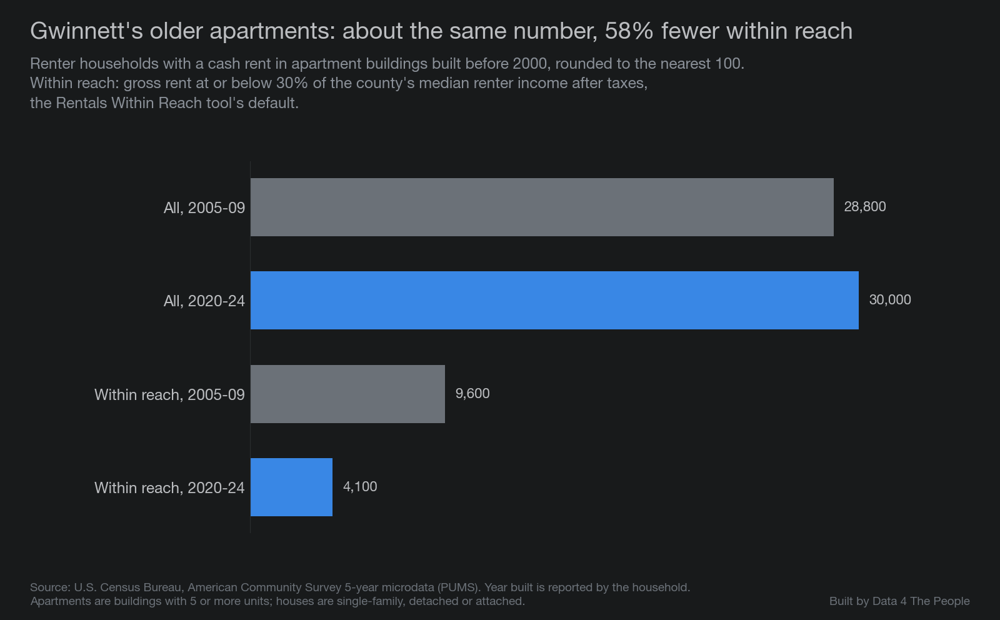
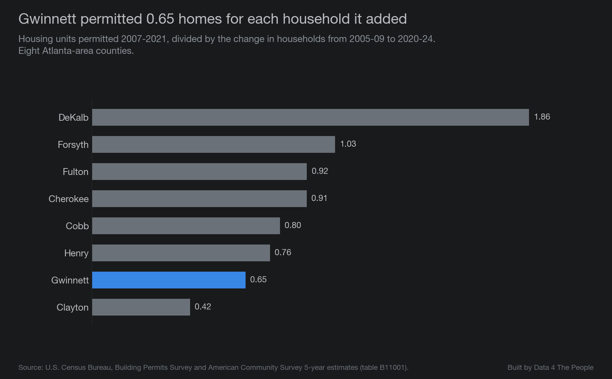
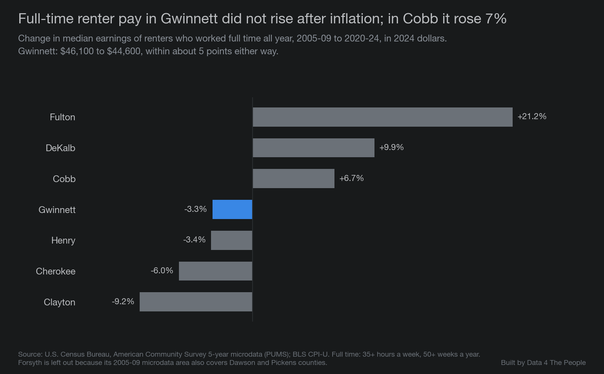

# [Eric: title]

[Eric: intro]

## The lowest share in the country, outside college counties

Our [Rentals Within Reach](https://www.data4thepeople.com/p/rentals-within-reach) tool measures how many of a county's rentals its median renter household could afford, spending 30% of its income after taxes on rent. In 2020-2024, Gwinnett County, Georgia, had the lowest share of the 1,922 counties we ranked, leaving out college counties.

*Source: Data 4 The People, Rentals Within Reach, from Census Bureau American Community Survey 5-year estimates, 2020-2024.*

Two caveats. Clayton County, also in metro Atlanta, is only half a point behind. And with college counties included, Gwinnett ranks third, behind Whitman County, Washington, and Benton County, Oregon. Three of the four lowest counties on this list are in the Atlanta area.

## A 59% decline

In 2005-2009, 25.5% of Gwinnett's rentals were within reach of its median renter household. By 2020-2024, 10.5% were. The national share was 32% at the start and 31% at the end. Gwinnett added rentals over those years, but the number within reach still fell.

*Source: Data 4 The People, Rentals Within Reach, from Census Bureau American Community Survey 5-year estimates. Rentals within reach are the tool's share times its count of rentals.*

## Rent rose 32%. Renter income rose 8%.

After inflation, Gwinnett's median rent rose 32% from 2005-2009 to 2020-2024, while its median renter household income rose 8%. Among the 15 Atlanta-area counties with at least 10,000 renter households, Gwinnett's gap between the two was one of the widest.

*Source: Census Bureau, American Community Survey 5-year estimates; BLS consumer price index. Gwinnett's income change has a margin of about 5 points either way.*

Home prices rose fast in Gwinnett, but they rose about as fast in Cobb County, where renters' income rose 18%.

## Not a story of high-priced new apartments

Apartments built since 2010 hold about 10% of Gwinnett's renters. Their median rent, $1,870, is 3% above the county's.

*Source: Census Bureau, American Community Survey 5-year microdata, 2020-2024. Year built is reported by the household.*

The bigger change was in older buildings. Gwinnett's apartments built before 2000 housed about the same number of renters in both periods. The number of them within reach fell 58%.

*Source: Census Bureau, American Community Survey 5-year microdata. Apartments are buildings with 5 or more units.*

Many older houses became rentals: houses went from 31% of Gwinnett's rentals in 2005-2009 to 39.5% in 2020-2024. And Gwinnett permitted fewer homes for each new household than most of its neighbors.

*Source: Census Bureau, Building Permits Survey and American Community Survey 5-year estimates. Permits are approvals to build, not finished homes.*

## Renters' pay did not keep up

Gwinnett's renter households earned more over this period mostly because the households changed: more members worked, more worked full time, and more householders were older or had college degrees. Pay itself did not rise. After inflation, the median renter who worked full time all year earned about $46,100 in 2005-2009 and $44,600 in 2020-2024. In Cobb, that pay rose 7%.

*Source: Census Bureau, American Community Survey 5-year microdata; BLS consumer price index. Gwinnett's change has a margin of about 5 points either way.*

Renter pay also fell in Henry, Cherokee and Clayton. In Gwinnett, rents rose about as much as in Cobb, while pay moved more like Henry's.

[Eric: closing]

::: divider

## What this does not tell you

- **Why.** These are patterns that came alongside the rise in rents. The data does not show what caused them.
- **Survey estimates.** Every number comes from a survey and has a margin of error. Gwinnett's lead over Clayton, and over the next counties in the Atlanta comparison, is small enough that the order could change.
- **One way to measure affordability.** "Within reach" uses the tool's default: the median renter household, after taxes, paying 30% of income. Other settings give other rankings.
- **Different people.** The survey takes two snapshots of different renters. It does not follow the same people over time.
- **Year built.** Households report when their building was built, and some may not know exactly.

## How we did this

- **Shares within reach** come from our Rentals Within Reach tool, built from Census Bureau American Community Survey 5-year estimates for 2005-2009, 2010-2014, 2015-2019 and 2020-2024. Counties with fewer than 1,000 rentals, or with unreliable estimates, are left out. College counties are the tool's 71 counties where 15% or more of residents age 3 and over are enrolled in college.
- **Rent and income changes** use the published median gross rent and median renter household income, put in 2024 dollars with the consumer price index.
- **Rent by year built, older apartments and renter pay** come from the survey's microdata (individual household records) for Gwinnett and six neighboring counties. Forsyth County is left out of these because its 2005-2009 records also cover Dawson and Pickens counties. Full time means 35 or more hours a week for 50 or more weeks a year.
- **Permits** come from the Census Bureau's Building Permits Survey.
- **Home prices** come from the Federal Housing Finance Agency's county house price index.
- An independent check recomputed every number from the raw data. The code and data notes are on [GitHub](https://github.com/Data4ThePeople/GwinnettCounty).
