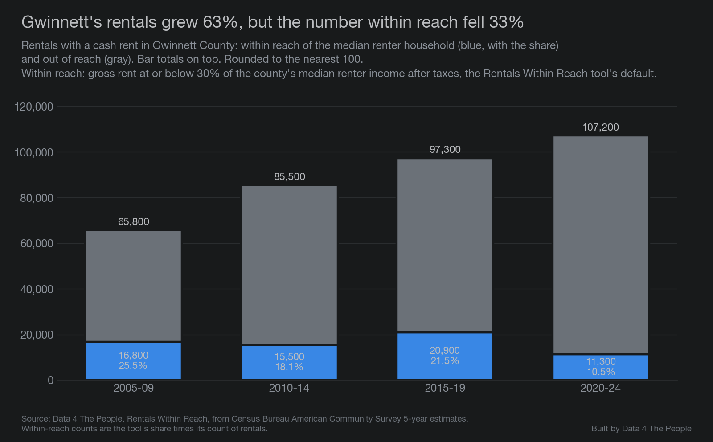

# Renters Can't Win It in Gwinnett

Last week, we dug into our [Rentals Within Reach](https://www.data4thepeople.com/p/rentals-within-reach) visualization and pulled out what looked like one of the most affordable counties in America for renters. That was [Dawson County, Nebraska](https://www.data4thepeople.com/p/lexington-tyson-plant-closure), and while it’s true that it used to be affordable, that all changed earlier this year when its largest employer – the Tyson meatpacking plant – shut its doors. 

Today, we went hunting on the opposite side of the ledger – the counties that were the least affordable for renters. Interestingly, three of the ten least affordable counties outside college counties were in the Atlanta metro area. But one county stood out from the rest – Gwinnett County, situated northeast of downtown Atlanta. Gwinnett County had just 10.5% of rental units “within reach” of the median renter household income. We define within reach as a rent of no more than 30% of the median renter household’s after-tax income. 

*Source: Data 4 The People, Rentals Within Reach, from Census Bureau American Community Survey 5-year estimates, 2020-2024. County lines: Census Bureau, 2024.*

## The lowest share in the country, outside college counties

Nationally, Gwinnett's 10.5% was the lowest of the 1,922 counties we ranked, leaving out college counties. We ranked counties with at least 1,000 rentals and reliable survey estimates.

*Source: Data 4 The People, Rentals Within Reach, from Census Bureau American Community Survey 5-year estimates, 2020-2024.*

With college counties included, Gwinnett ranks third, behind Whitman County, Washington (home of Washington State University), and Benton County, Oregon (home of Oregon State University).

## A 59% decline

In 2005-2009, 25.5% of Gwinnett's rentals were within reach of its median renter household. By 2020-2024, 10.5% were. The national share was 32% at the start and 31% at the end. Gwinnett added rentals over those years, but the number within reach still fell.

*Source: Data 4 The People, Rentals Within Reach, from Census Bureau American Community Survey 5-year estimates. Rentals within reach are the tool's share times its count of rentals.*

## Rent rose 32%. Renter income rose 8%.

After inflation, Gwinnett's median rent rose 32% from 2005-2009 to 2020-2024, while its median renter household income rose 8%. Among the 15 Atlanta-area counties with at least 10,000 renter households, Gwinnett's gap between the two was one of the widest.

*Source: Census Bureau, American Community Survey 5-year estimates; BLS consumer price index. Gwinnett's income change has a margin of about 5 points either way.*

For context, look at Newton County. Its median renter household income rose 9%, the closest of these 15 counties to Gwinnett's 8%. Its median rent rose just 14%, paling in comparison to Gwinnett's 32% surge. Newton's income figure has a wide margin, about 13 points either way. 

## New rentals came in out of reach

The problem here is not that rental units in Gwinnett didn't grow. They did. 

Gwinnett added about 41,000 rentals over this period. Three kinds account for about 70% of them:

- About 11,300 more rentals in older houses, built before 2000
- About 11,000 apartments built since 2010
- About 6,700 houses built since 2010

The typical rental in each of the three cost more than the median renter household could afford: about $1,250 a month, 30% of its after-tax income. In 2020-2024, older houses rented for a median of about $1,990 and new apartments for $1,870. About 10% of the older houses and 8% of the new apartments were within reach. Houses built since 2010 rented for a median of about $2,500, and 2% were within reach.

*Source: Census Bureau, American Community Survey 5-year microdata. Rents include utilities.*

But it gets worse. Not only were the new units out of reach, but the older units that used to be within reach in 2005-2009 moved out of reach too.

Over our study period, Gwinnett lost about 5,500 rentals within reach, despite gaining about 41,000 rentals overall. Most of that drop was in older apartments, built before 2000. Gwinnett had about the same number of them in both periods, but their median rent went from about $860 to $1,660, up 92%. After inflation, that is a 31% rise, while the amount the median renter household could afford rose 8%. In 2005-2009, the median older apartment rented for about $100 more than that amount. By 2020-2024, it was about $400 more.

*Source: Census Bureau, American Community Survey 5-year microdata; Data 4 The People, Rentals Within Reach. Amounts in 2024 dollars.*

In other words, most of the rentals added cost more than the median renter household could afford, and the older apartments that used to be close to reach rose far faster than renters' income.

## Renters' pay did not keep up

Why did renter income not keep up? To answer that, we looked at pay: what one renter who worked full time all year earned. Household income adds up everyone in the household, so it can rise even when pay does not, if more people in the household work or work more hours. Pay isolates what renters are getting paid.

Gwinnett's renter households did change. Households with two or more workers went from 34% to 37% of renter households. Among renters who worked, the share working full time all year rose from 66% to 76%. Householders with a bachelor's degree or more went from 23% to 30%. Changes like these can lift household income even when pay stays flat.

And pay itself showed no measurable rise. After inflation, the median renter who worked full time all year earned about $46,100 in 2005-2009 and $44,600 in 2020-2024. In Cobb, that pay rose 7%.

Few counties with rents rising this fast saw a drop in full-time renter pay. We looked at 37 counties in large metro areas where rent rose 25% or more after inflation and the survey can measure the county on its own. Only two showed a drop in full-time renter pay: Gwinnett, and Cherokee County, also in metro Atlanta. Both drops are within the survey's margin of error, Cherokee's by a wide amount. In the middle county of the group, it rose 15%.

*Source: Census Bureau, American Community Survey 5-year microdata; BLS consumer price index. Lines show 90% margins: about 5 points either way for Gwinnett and 11 for Cherokee, so the order near the bottom is not certain. Another 44 counties with rent up 25% or more share a microdata area with a neighbor and could not be measured on their own.*

## “Hotlanta” - for rents, not renter incomes

We really tried hard to keep this analysis focused on Gwinnett County. With the lowest percent of rentals within reach among the 1,922 U.S. counties we ranked, outside college counties, it deserved the attention. But notice how all throughout this analysis, other neighboring Atlanta-area counties kept making appearances on the charts. The analysis does not support one neat and tidy cause and effect conclusion encompassing the entire Atlanta metro area, but the data does suggest that something is going on around this city that is making many areas especially difficult for renters. Rental prices are rising like one would expect in Hotlanta, but the incomes aren’t climbing with it. Among the large Atlanta-area counties, Gwinnett had one of the widest gaps between the change in rental prices and renter incomes. But is Gwinnett unique, or is it just where this perfect storm came together around Atlanta? We don’t know… but would love to hear from residents to help fill in the experiential gaps to which the data is blind.

Our other takeaway was how different this was from Dawson County's story. Dawson County was about a small county relying on one large employer, a risk many small counties share. Gwinnett County, from what we can tell, is a math story: what matters is the ratio between your income and your expenses. Over the past twenty years, rising housing costs worked in favor of people who owned homes in Gwinnett and against people who rented. Renters lost especially hard in Gwinnett, but rents are outpacing renter incomes in other places too. When rents outpace renter incomes year after year, it can work like a gravitational pull, widening the gap between the economic prospects of renters and homeowners in America.

In my view, this is very sad. For many people, renting is the step before owning a home. How are renters in Gwinnett supposed to save for a house if the median renter household must spend 43% of its after-tax income on the median rental?

Our job is to provide the tools and analysis to help you understand the data. It’s not policy. But geez this is depressing for those seeking the American Dream (without wealthy parents to finance it for them). Hopefully some smart minds come together to first acknowledge this problem, and then enact solutions to give people some hope for days when there can be a better match between wages and affordable rentals.

::: divider

## What this does not tell you

- **Why.** These are patterns that came alongside the rise in rents. The data does not show what caused them.
- **Survey estimates.** Every number comes from a survey and has a margin of error. Gwinnett's lead over Clayton, and over the next counties in the Atlanta comparison, is small enough that the order could change.
- **One way to measure affordability.** "Within reach" uses the tool's default: the median renter household, after taxes, paying 30% of income. Other settings give other rankings.
- **Different people.** The survey takes two snapshots of different renters. It does not follow the same people over time.
- **Year built.** Households report when their building was built, and some may not know exactly.

## How we did this

- **Shares within reach** come from our Rentals Within Reach tool, built from Census Bureau American Community Survey 5-year estimates for 2005-2009, 2010-2014, 2015-2019 and 2020-2024. Counties with fewer than 1,000 rentals, or with unreliable estimates, are left out. College counties are the tool's 71 counties where 15% or more of residents age 3 and over are enrolled in college.
- **Rent and income changes** use the published median gross rent and median renter household income, put in 2024 dollars with the consumer price index.
- **Rentals by building type and year built, rents of older apartments, and renter pay,** come from the survey's microdata (individual household records) for Gwinnett and six neighboring counties. Forsyth County is left out of these because its 2005-2009 records also cover Dawson and Pickens counties. Full time means 35 or more hours a week for 50 or more weeks a year.
- **Home prices** come from the Federal Housing Finance Agency's county house price index.
- An independent check recomputed every number from the raw data. The code and data notes are on [GitHub](https://github.com/Data4ThePeople/GwinnettCounty).
